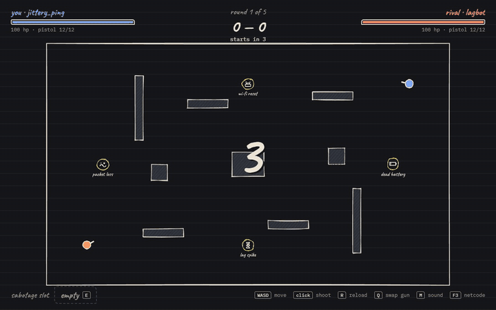
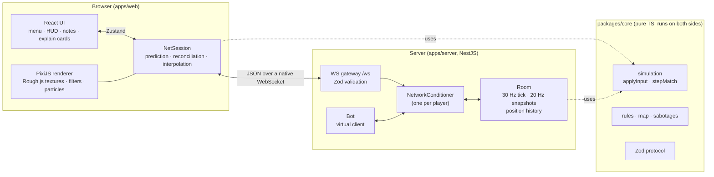

# Lag Switch

[](https://github.com/aadolfo8/lag-switch/actions/workflows/ci.yml)

**A 1v1 top-down duel in the browser where the special weapons are everything that goes wrong when you play online.** Lag spikes, packet loss, your mom rebooting the Wi-Fi, a dead controller battery.

The sabotages are not animations. The authoritative server **really** delays, drops or cuts the victim's traffic, and the netcode has to cope. Between rounds, a card explains what just happened on the wire.

**▶ Play it: [lagswitch.hidan.es](https://lagswitch.hidan.es)**. "play vs bot" drops you into a match in under a second, no sign-up.



## Why

I wanted a portfolio project whose interesting part is invisible: the netcode. Most multiplayer demos hide it behind a library. Here there is no Socket.IO, no Colyseus and no game engine. Every piece is small, commented and tested, so I can walk through it line by line:

- an **authoritative server** with a fixed 30 Hz tick,
- **client-side prediction with reconciliation**, so your own movement is instant at any ping,
- **entity interpolation**, so your rival moves smoothly at 60 fps out of 20 snapshots per second,
- **lag compensation** for hitscan weapons,
- a **network conditioner** that makes all of the above visible on purpose.

## How to play

| Key             | Action                                                                            |
| --------------- | --------------------------------------------------------------------------------- |
| <kbd>WASD</kbd> | move                                                                              |
| mouse / click   | aim / shoot                                                                       |
| <kbd>R</kbd>    | reload                                                                            |
| <kbd>Q</kbd>    | swap pistol ↔ shotgun                                                             |
| <kbd>E</kbd>    | fire the sabotage you picked up                                                   |
| <kbd>F3</kbd>   | netcode overlay: ping, tick, snapshots/s, bytes/s, unacked inputs, active effects |
| <kbd>M</kbd>    | sound on/off                                                                      |

Best of 5 rounds, 60 s each (the healthier player wins on timeout). Sabotages lie around the map and respawn 15 s after being picked up:

| Sabotage                | What the server really does to your rival                      | Lasts | Concept it explains                     |
| ----------------------- | -------------------------------------------------------------- | ----- | --------------------------------------- |
| Lag spike               | +200 ms each way on their connection (+400 ms of ping)         | 5 s   | latency, prediction, lag compensation   |
| Packet loss             | drops 25 % of their messages, both directions                  | 5 s   | loss, input redundancy, full snapshots  |
| Mom reboots the Wi-Fi   | **closes their socket**, refuses reconnects, then resyncs them | 3 s   | disconnection, reconnect tokens, resync |
| Dead controller battery | their inputs still arrive; the simulation ignores them         | 2 s   | inputs vs. server authority             |

## Architecture



- **`packages/core`** is the game: data model, movement and collisions, weapons, rounds, the sabotage registry, the netcode helpers and the Zod schemas of every message. It imports nothing from the DOM, Node, Pixi or Nest. That is enforced twice: its `tsconfig` has no DOM lib and no Node types, and a Biome rule forbids those imports. The server runs it to decide what happens; the client runs **the same code** to predict.
- **`apps/server`** is NestJS used thinly: an HTTP controller (`POST /api/rooms`), a native `ws` gateway, static hosting for the SPA. The real work happens in plain classes (`Room`, `NetworkConditioner`, `Bot`) that are unit-tested without Nest.
- **`apps/web`** is Vite + React + PixiJS 8 (WebGPU with a WebGL2 fallback). React draws everything that is text; Pixi draws the arena. The game loop writes to a Zustand store and React reads it with narrow selectors.

## Netcode

The full story, in the order a message travels. Every bullet points at the file that implements it.

**Fixed tick, full snapshots.** The server simulates at 30 Hz with a fixed 33.3 ms step ([`TickLoop`](apps/server/src/game/TickLoop.ts) schedules against absolute time, so it doesn't drift) and sends every client a **complete** snapshot of the match 20 times a second ([`Room.sendSnapshots`](apps/server/src/game/Room.ts)). No delta compression in v1: a lost snapshot never breaks the next one.

**Inputs, not positions.** The client never says where it is. Every 33.3 ms it sends what the player is pressing, tagged with an increasing `seq`, plus the two previous unacknowledged inputs (**redundancy**: an input is only lost if three packets in a row are). The server validates every frame with Zod, de-duplicates by `seq`, and applies at most ~1 input per tick per player (an **input budget**, so a modified client can't move faster by sending more), then echoes `lastProcessedSeq` in each snapshot.

**Prediction and reconciliation** ([`core/netcode/prediction.ts`](packages/core/src/netcode/prediction.ts), [`NetSession`](apps/web/src/game/NetSession.ts)). The client applies each input locally the moment it samples it, with the exact `applyInput` the server uses, and keeps the inputs the server hasn't confirmed. When a snapshot says "this is you after input #39", the client restarts from that authoritative state and replays inputs #40+ on top. If the server agreed, nothing visibly changes. Weapon timers count down per input step, not against a wall clock, so ammo and reloads replay identically too. Small corrections (< 64 px) are smoothed out over ~80 ms; big ones (respawn) snap.

**Interpolation** ([`core/netcode/interpolation.ts`](packages/core/src/netcode/interpolation.ts)). The rival is drawn **100 ms in the past**, blended between the two snapshots around that moment, on a server clock estimated from snapshot arrivals. Two snapshot intervals of buffer mean one lost or late snapshot is invisible. Past the newest snapshot it holds instead of extrapolating: a wrong guess looks worse than a pause.

**Lag compensation** ([`core/netcode/history.ts`](packages/core/src/netcode/history.ts)). Shots are hitscan. The server keeps one second of positions and, for each shot, rewinds the other players to what the shooter was looking at: `now − RTT/2 − 100 ms`, capped at 250 ms. A [test](apps/server/src/game/lagcomp.test.ts) fires the same shot at a moving target and checks that it hits with compensation and misses without it.

**The network conditioner** ([`NetworkConditioner`](apps/server/src/net/NetworkConditioner.ts)). Every message to or from a player goes through two ordered lanes (in and out) that can add delay and jitter, drop messages, or block everything. Order is kept as TCP would keep it. Sabotages only change those numbers ([`core/sabotages`](packages/core/src/sabotages)), and the server re-syncs each player's lanes with their active effects every tick. The bot is a virtual client that goes through its own conditioner, so sabotages hit it for real.

**Reconnection.** `welcome` carries a secret `reconnectToken`. When a socket drops (for real, or because the Wi-Fi reset sabotage closed it with code 4001), the client retries every 500 ms with the token; the server keeps the seat for 10 s, then answers `welcome { resumed: true }` plus a full snapshot, and the client rebuilds its state from it. If you're not back in 10 s you lose the round.

### Limits, on purpose

- **JSON over TCP.** Readable in DevTools and easy to explain, but snapshots cost ~1.1 KB and WebSockets can't drop a late packet (TCP retransmits and stalls instead). The conditioner simulates loss at the message level, which is what a UDP game would see. A binary protocol (and WebTransport) is the next step.
- **Full snapshots** trade bandwidth for robustness. With two players it's ~23 KB/s down; with 20 players, deltas against the last acknowledged snapshot would be needed.
- **Determinism across engines** isn't guaranteed (V8 and other engines may round `Math.sin` differently). It doesn't matter here: the client never trusts its own simulation for longer than one round trip.
- **Only your own player is predicted.** Hits, damage and pickups are always the server's call; your tracer is drawn instantly but where it lands is up to the server.
- **One process, rooms in memory.** Fine for a demo. Scaling out would need sticky routing by room code.

### Measured

Locally, Chrome against the production build, a match against the bot, steady state over 10 s:

| Metric                            | Value                                                                    |
| --------------------------------- | ------------------------------------------------------------------------ |
| Server tick                       | 30 Hz (33.3 ms step)                                                     |
| Snapshots                         | 20 / s, ~1.14 KB each (full state, JSON)                                 |
| Download per player               | ~22.9 KB/s                                                               |
| Upload per player                 | ~6.6 KB/s (30 input messages/s, ~218 B each with redundancy)             |
| Interpolation delay               | 100 ms                                                                   |
| Max lag-compensation rewind       | 250 ms                                                                   |
| `?lag=150` (simulated 150 ms RTT) | own movement on screen within one frame; 0.0 px corrections while moving |
| Frame rate                        | 60 fps, worst frame 17 ms                                                |
| Menu → live match vs bot          | ~0.6 s                                                                   |
| Initial JS (gzip)                 | ~172 KB; PixiJS loads when a match starts                                |

Try it yourself: add `?lag=150` to a room or bot URL to simulate latency on your own connection, and press <kbd>F3</kbd>.

## Run it locally

Requirements: Node 24 and pnpm 10.

```bash
pnpm install
pnpm dev          # Vite on http://localhost:5173, Nest on :3000 (Vite proxies /api and /ws)
```

Open http://localhost:5173 and press "play vs bot". For a two-player test, create a room and open the link in a second browser window. `/play/local` runs the whole simulation in the browser against a practice dummy, with no server.

| Command          | What it does                                                                                                                   |
| ---------------- | ------------------------------------------------------------------------------------------------------------------------------ |
| `pnpm dev`       | web, server and core in watch mode (Turborepo)                                                                                 |
| `pnpm build`     | builds every package (cached)                                                                                                  |
| `pnpm test`      | Vitest: simulation, reconciliation, interpolation, lag compensation, conditioner, rooms, bot                                   |
| `pnpm typecheck` | `tsc --noEmit` everywhere                                                                                                      |
| `pnpm lint`      | Biome lint and format check                                                                                                    |
| `pnpm e2e`       | Playwright smoke tests against the production build (run `pnpm build` first; `PW_CHANNEL=chrome` reuses your installed Chrome) |

CI (GitHub Actions) runs Biome, typecheck, Vitest, the build, Playwright and a Docker build on every push.

## Deploy

One container: Nest serves the API, the WebSocket and the built SPA on port 3000. On the VPS it sits behind the shared Caddy in `/srv/proxy`, on the external Docker network `proxy` with the alias `lagswitch`. No ports are published on the host.

```bash
# on the VPS
git clone https://github.com/aadolfo8/lag-switch.git && cd lag-switch
docker compose up -d --build
```

Add this block to the Caddyfile in `/srv/proxy` (also in [`deploy/Caddyfile.snippet`](deploy/Caddyfile.snippet)); `reverse_proxy` passes WebSocket upgrades through with no extra configuration:

```caddyfile
lagswitch.hidan.es {
	reverse_proxy lagswitch:3000
}
```

Then reload Caddy (adjust the service name to your `/srv/proxy` setup):

```bash
cd /srv/proxy && docker compose exec caddy caddy reload --config /etc/caddy/Caddyfile
```

To update: `git pull && docker compose up -d --build`. The image runs as the `node` user and has a healthcheck on `/api/health`.

## Stack decisions

| Piece           | Choice                                     | Why                                                                                                         |
| --------------- | ------------------------------------------ | ----------------------------------------------------------------------------------------------------------- |
| Monorepo        | pnpm workspaces + Turborepo                | one `core` shared by client and server; cached builds                                                       |
| Simulation      | `packages/core`, pure TypeScript           | the same code is authoritative on the server and predictive on the client                                   |
| Server          | NestJS + `@nestjs/platform-ws`             | native WebSocket. Socket.IO's own protocol and auto-reconnect would hide exactly what this project is about |
| Validation      | Zod 4                                      | the server validates every client frame; the client gets the types                                          |
| Render          | PixiJS 8                                   | rendering and filters only. The loop, input, camera and particles are ours (no Phaser)                      |
| Hand-drawn look | Rough.js → textures                        | every shape baked once in 3 variants, flipped at 8 fps for the boiling line; Rough.js never runs per frame  |
| UI              | React + TanStack Router + Zustand + Motion | crisp text in Caveat; the game loop writes, React reads                                                     |
| Sound           | @pixi/sound                                | every effect is synthesised in code, so there are no audio files                                            |
| Quality         | Biome, Vitest, Playwright, GitHub Actions  |                                                                                                             |

## Project structure

```
packages/core/       simulation, rules, map, sabotages, netcode helpers, Zod protocol
  src/netcode/       prediction.ts · interpolation.ts · history.ts
  src/sabotages/     one file per sabotage + the registry
apps/server/         NestJS: gateway, rooms, tick loop, conditioner, bot
  src/game/          Room.ts · RoomRegistry.ts · TickLoop.ts · game.gateway.ts
  src/net/           NetworkConditioner.ts
  src/bot/           Bot.ts · BotBrain.ts · nav.ts
apps/web/            Vite + React + PixiJS client
  src/game/          GameClient (loop) · NetSession · WorldRenderer · art/ · fx/ · audio/
  src/components/    HUD, notes, explain cards, diagrams, F3 overlay
e2e/                 Playwright smoke tests
Dockerfile · docker-compose.yml · deploy/Caddyfile.snippet
```

## What's next

- **More sabotages**: "screen goes black" (play blind for 2 s), jitter storms, a bandwidth cap that forces lower snapshot rates.
- **Binary protocol** and delta snapshots against the last acknowledged state; WebTransport for real unreliable delivery.
- **Ranking** with accounts and Postgres.
- **Learn mode**: a lab where you drag the conditioner's sliders yourself and watch prediction, interpolation and lag compensation react.
- Touch controls and mobile layout.

## License

[MIT](LICENSE)
